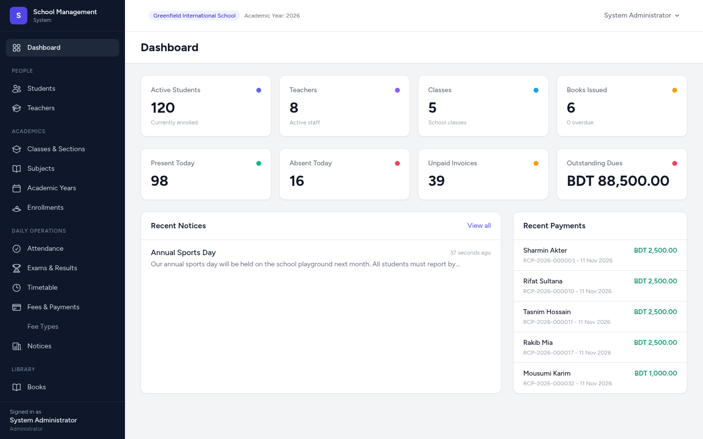
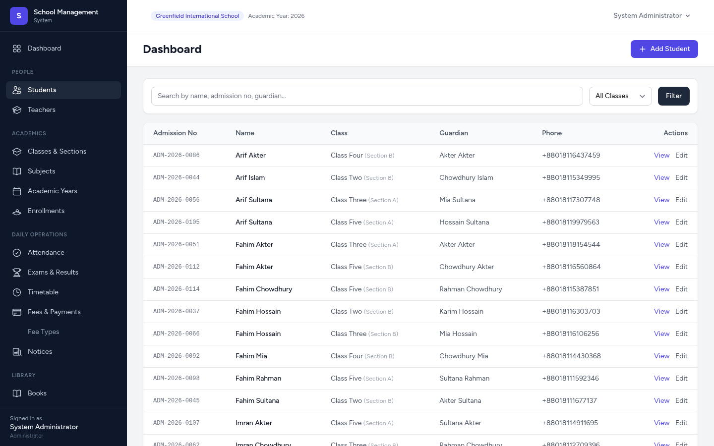
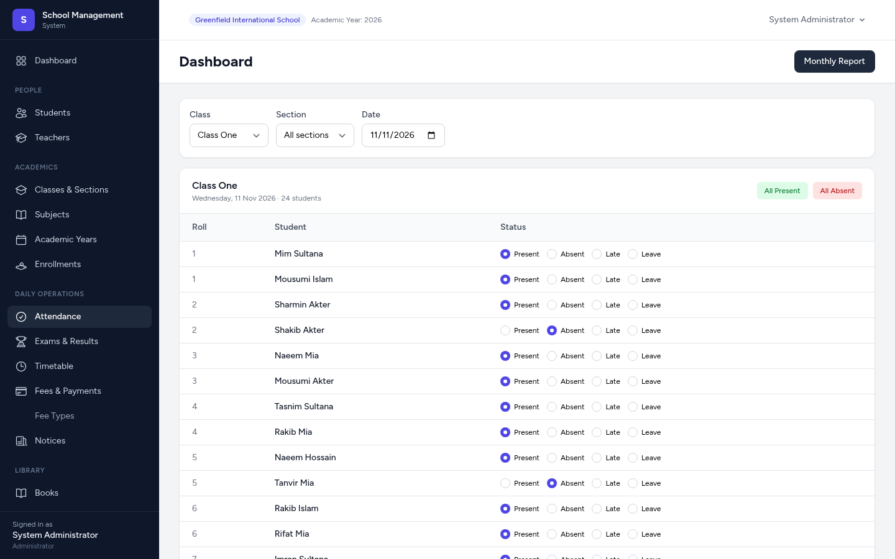
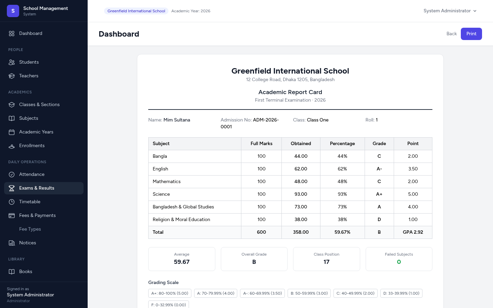

<div align="center">

# School Management System

**A comprehensive, open-source school management system built with Laravel.**

Students · Teachers · Classes · Attendance · Exams & Report Cards · Fees & Payments ·
Library · Timetable · Notices · REST API

[](https://laravel.com)
[](https://php.net)
[](https://www.postgresql.org)
[](LICENSE)

</div>

---

## Overview

School Management System is a full-featured web application for managing an entire
school: admissions and student records, teaching staff, classes and sections,
subjects, daily attendance, examinations with automated grading and printable
report cards, monthly fee invoicing and payment collection, a lending library,
class timetables, and audience-targeted notices — plus a documented REST API for
integrations.

It is an **independent open-source project**. It is not affiliated with Laravel,
its maintainers, or any other project referenced in this documentation.

Every number shown in the interface comes from live application data. There are
no fake statistics or placeholder results.

## Screenshots

| Dashboard | Students |
|---|---|
|  |  |

| Attendance | Report Card |
|---|---|
|  |  |

## Features

### People & academics
- **Students** — admission records, guardian details, search & filters, per-student profiles with attendance, fee and library history.
- **Teachers** — staff records, optional login accounts, subject assignments.
- **Classes & sections** — capacity, class teachers, subject-teacher assignment per class.
- **Subjects** — core/elective, unique codes, assignment to multiple classes.
- **Academic years** — mark one year as current; enrollment, exams and fees are always year-aware.
- **Enrollments** — one enrollment per student per academic year, roll numbers, status tracking.

### Daily operations
- **Attendance** — class/section daily marking with "all present" shortcuts, upsert-safe (re-saving a day updates instead of duplicating), monthly per-student summary report, weekend (Friday) aware.
- **Exams & marks** — per-class exams, grid marks entry per subject, validation against maximum marks, publish/draft states.
- **Report cards** — computed totals, percentage, GPA and letter grades from configurable **grade bands** (Bangladeshi A+…F scale seeded by default), class position, failed-subject count, print-friendly layout.
- **Fees** — fee types, single or bulk monthly invoice generation per class (duplicate-safe), discounts and fines, partial payments, payment receipts, automatic `unpaid → partial → paid` status transitions.
- **Library** — book catalogue with copy tracking, issue/return with availability checks, overdue detection, fines.
- **Timetable** — class/section weekly periods with class-slot and teacher-conflict detection.
- **Notices** — audience targeting (all/teachers/students/parents), scheduled publishing, active/inactive.

### Platform
- **Role-based access control** — `admin`, `teacher`, `student`, `parent` with middleware + policies; students see only their own data, parents only their children's.
- **REST API** — token-based (Laravel Sanctum) versioned under `/api/v1`. See [docs/API.md](docs/API.md).
- **Dashboard** — real-time statistics for every role.
- **Dark mode**, responsive layout, print-friendly report cards.
- **115 automated tests** (257 assertions) covering auth, RBAC, every module, and the API.

## Technology stack

| Layer | Technology |
|---|---|
| Backend | PHP 8.3+, Laravel 13, Eloquent ORM |
| Database | PostgreSQL (production) / SQLite (development & tests) |
| Queue & cache | Redis (optional in small deployments) |
| Frontend | Blade, Tailwind CSS 4, Alpine.js, Vite |
| Auth | Laravel Breeze (sessions) + Sanctum (API tokens) |
| Infrastructure | Docker Compose (Nginx + PHP-FPM + PostgreSQL + Redis + queue worker) |

## Getting started

### Option 1 — Docker (recommended)

```bash
git clone https://github.com/SultanBayezid/school-management-system.git
cd school-management-system
cp .env.example .env

docker compose up -d --build

# one-time setup
docker compose exec app composer install
docker compose exec app php artisan key:generate
docker compose exec app php artisan migrate --seed
docker compose exec app npm install && docker compose exec app npm run build
```

Open http://localhost:8080 and log in:

| Account | Email | Password |
|---|---|---|
| Administrator | `admin@school.test` | `password` |

> For a demo school with students, attendance, exams, fees, library data,
> set `DEMO_SEED=true` in `.env` before running `migrate --seed`.

### Option 2 — Traditional VPS (Ubuntu 22.04/24.04)

**1. Install dependencies**

```bash
sudo apt update
sudo apt install -y php8.3-fpm php8.3-cli php8.3-pgsql php8.3-gd php8.3-zip \
    php8.3-mbstring php8.3-xml php8.3-curl php8.3-bcmath \
    postgresql redis-server nginx composer nodejs npm
```

**2. Create the database**

```sql
CREATE DATABASE school_management;
CREATE USER school WITH ENCRYPTED PASSWORD 'strong-password';
GRANT ALL PRIVILEGES ON DATABASE school_management TO school;
```

**3. Configure the application**

```bash
git clone https://github.com/SultanBayezid/school-management-system.git /var/www/school
cd /var/www/school
cp .env.example .env
# edit .env: set DB_CONNECTION=pgsql and credentials
composer install --no-dev --optimize-autoloader
php artisan key:generate
php artisan migrate --seed
npm install && npm run build
php artisan storage:link

sudo chown -R www-data:www-data storage bootstrap/cache
```

**4. Nginx server block**

```nginx
server {
    listen 80;
    server_name school.example.com;
    root /var/www/school/public;

    index index.php;

    location / {
        try_files $uri $uri/ /index.php?$query_string;
    }

    location ~ \.php$ {
        fastcgi_pass unix:/run/php/php8.3-fpm.sock;
        fastcgi_param SCRIPT_FILENAME $realpath_root$fastcgi_script_name;
        include fastcgi_params;
    }

    location ~ /\.(?!well-known).* {
        deny all;
    }
}
```

**5. Queue worker (optional but recommended)**

```bash
sudo crontab -e
# add: * * * * * cd /var/www/school && php artisan schedule:run >> /dev/null 2>&1
```

```ini
# /etc/systemd/system/school-worker.service
[Unit]
Description=School Management queue worker
After=network.target

[Service]
User=www-data
Restart=always
ExecStart=/usr/bin/php /var/www/school/artisan queue:work --sleep=3 --tries=3

[Install]
WantedBy=multi-user.target
```

```bash
sudo systemctl enable --now school-worker
```

## Configuration

All configuration lives in `.env` (copy from `.env.example`). Key options:

| Variable | Purpose |
|---|---|
| `APP_NAME` | School name shown in the UI |
| `DB_CONNECTION` | `sqlite` (dev) or `pgsql` (production) |
| `DEMO_SEED` | `true` seeds a realistic demo school (5 classes, 120 students, attendance, exams, fees, library) |
| `QUEUE_CONNECTION` | `sync` (simple) or `redis` (production) |

After seeding, configure the school identity under **Settings** (name, address,
principal) — it appears on invoices and report cards.

Default login after seeding: `admin@school.test` / `password` (change it
immediately in production).

## API documentation

The full REST API (versioned under `/api/v1`) is documented in
[docs/API.md](docs/API.md) with authentication, endpoints, request/response
examples and error codes.

Quick example:

```bash
# obtain a token
curl -X POST http://localhost:8080/api/v1/auth/login \
  -H "Accept: application/json" \
  -H "Content-Type: application/json" \
  -d '{"email":"admin@school.test","password":"password"}'

# list students
curl http://localhost:8080/api/v1/students?search=rahim \
  -H "Authorization: Bearer <token>" \
  -H "Accept: application/json"
```

## Testing

```bash
php artisan test
```

The suite covers authentication, registration lock-down, role-based access
control, student/teacher CRUD, attendance (including upsert and validation),
exam marks and grading, invoice generation and payment logic, notice audience
scoping, library flows, the REST API, and unit tests for the grade and invoice
calculation services — 115 tests, 257 assertions.

## Project structure

```
app/
├── Http/
│   ├── Controllers/         # Web controllers (one per module)
│   ├── Controllers/Api/V1/  # REST API controllers
│   ├── Middleware/          # CheckRole (RBAC)
│   ├── Requests/            # Form request validation
│   └── Resources/           # API resources
├── Models/                  # Eloquent models
├── Policies/                # Authorization policies
└── Services/                # GradeService, InvoiceService, AttendanceService
database/
├── migrations/              # 21 domain migrations
├── factories/               # Test factories
└── seeders/                 # Settings, grades, admin + demo data
docs/API.md                  # REST API documentation
docker-compose.yml           # Full development/production stack
```

## Known limitations

- The timetable does not yet check room conflicts across classes sharing a room.
- Report cards are print-friendly HTML; dedicated PDF export is not implemented.
- Fee invoices are per fee type + month; there is no student-level fee waiver engine (discounts are per-invoice).
- Bangla localization of the interface is not included yet (data in Bangla works fine — the stack is fully UTF-8).

## Roadmap

- [ ] PDF export for report cards and invoices
- [ ] SMS/Email notifications for notices and fee due dates
- [ ] Bangla interface translation
- [ ] ID card generation
- [ ] Transport / hostel modules
- [ ] Bulk CSV import for students

## Contributing

Contributions are welcome! Please read [CONTRIBUTING.md](CONTRIBUTING.md) for the
process and coding standards. By participating you agree to the
[Code of Conduct](CODE_OF_CONDUCT.md).

## Security

Found a security issue? Please follow the responsible disclosure process in
[SECURITY.md](SECURITY.md).

## License

This project is open-source software licensed under the [MIT License](LICENSE).

## Author

**Sultan Bayezid** — Senior Full Stack Software Engineer

- Website: [https://lastlineweb.com](https://lastlineweb.com)
- Email: [sultanbayezidai@gmail.com](mailto:sultanbayezidai@gmail.com)
- Location: Bangladesh
- GitHub: [@SultanBayezid](https://github.com/SultanBayezid)
